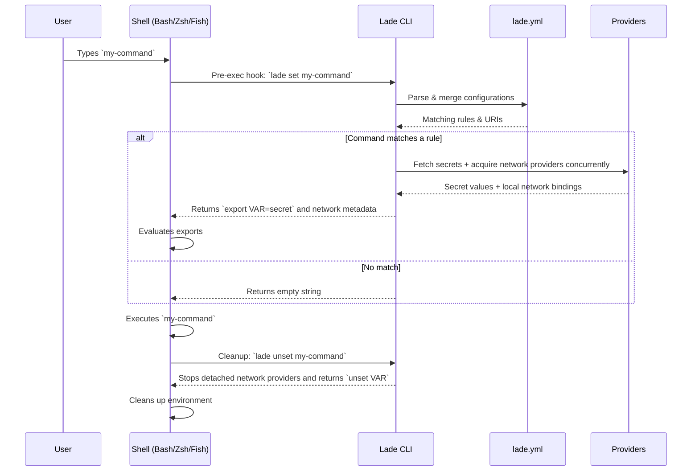
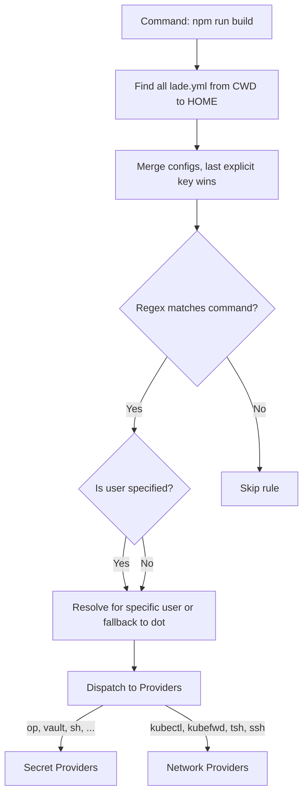
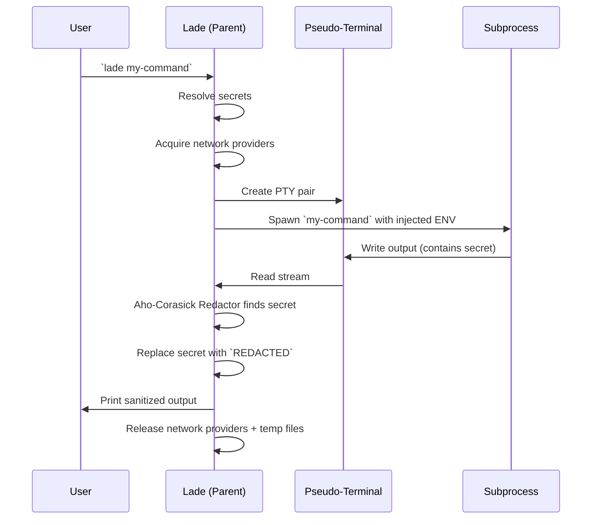
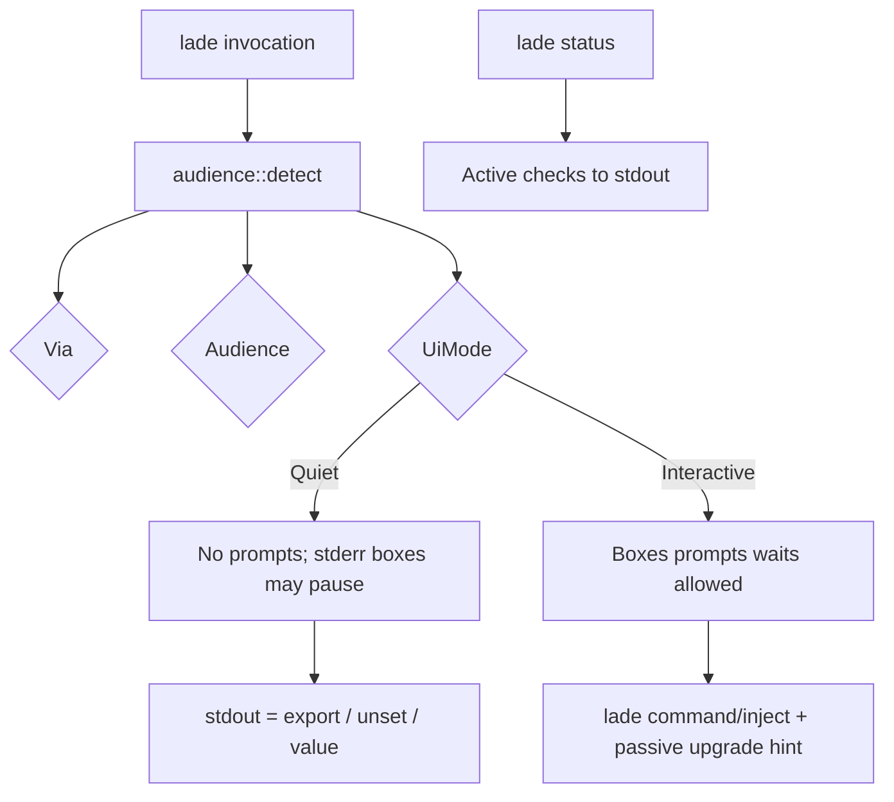

# Lade Architecture

Match tickets (T) are specified in [protocol.md](protocol.md).
Observability is specified in [observability.md](observability.md).
Environment variables are listed in [env.md](env.md).
Secret cache is in [cache.md](cache.md).
The public CLI is in [cli.md](cli.md).

## 1. High-Level Flow (Shell Hooks)

When a user runs `lade on`, Lade registers a pre-exec hook in their shell (Bash, Zsh, or Fish). This hook intercepts commands before they are run to check if they require secrets.



## 2. Configuration Resolution

Lade walks from the current directory up to `$HOME`, loads every
`lade.yaml` / `lade.yml` it finds, then evaluates the rules against
the current command. `~/lade.yaml` is included. Parents above `$HOME`
are not. A later file overlays the same key. Last explicit `log`
wins.



Lade keeps two provider families under one registry:

- **Secret providers** resolve values (env/file hydration).
- **Network providers** acquire temporary local port bindings for the command.

URI parse, CLI version tables, and tunnel command builders live in
`lade-sdk`. The CLI owns process lifecycle (spawn, ready wait,
restart, kill).

`age-plugin-lade` is a separate crate (`crates/age-plugin-lade`).
`argv0` or `--age-plugin=` selects the
[C2SP age-plugin](https://c2sp.org/age-plugin) state machines. The
payload is a Lade URI. The plugin execs `lade eval` (sibling of the
plugin, then `PATH`, or `LADE_BIN`). Hydrate is the same path as a
typed `lade eval` (`hydrate_one`, no `lade.yml`). The age crate then
wraps or unwraps with whatever that URI returned (X25519, SSH, tagged,
post-quantum `age1tagpq1`). No network providers. No disclaimer.

Go age 1.3 post-quantum keys (`age1pq1`, `AGE-SECRET-KEY-PQ-1`) are
not in rage 0.12 (str4d/rage#632 targets 0.13). Until then
`age-plugin-pq` from the Go age 1.3.2 release does that crypto
(`crates/age-plugin-lade/src/pq.rs`). An `age1pq1` recipient is already
a plugin recipient. A secret goes through `age-plugin-pq -identity` on
a pipe and comes back as an `AGE-PLUGIN-PQ-1` identity. The age crate
then runs `age-plugin-pq` as a nested plugin. No line of the hydrated
value may be an `AGE-PLUGIN-` identity, so the plugin never calls
itself.

The plugin reports the labels of the keys it hydrated, before it wraps.
A post-quantum key carries `postquantum`, so age refuses to put it in a
file with a classic recipient, as it does for its own keys.

For shell hooks, `lade set` must finish both secret hydration and network
acquisition before it can print the shell exports. When a matching rule contains
network providers, the visible pre-command latency is therefore the slower of
secret resolution and tunnel readiness.

## 3. Execution, Network Acquire & Masking (`lade <command>` / `lade inject <command>`)

When using the top-level shortcut `lade <command>` (or the explicit form
`lade inject <command>`, or in environments where shell hooks aren't
available), Lade wraps the command execution. It resolves secrets, acquires any
matching network providers, then starts the child command. The wrap skips
the user profile (`fish --no-config`, `zsh -f`, `$BASH_ENV` unset) so
startup files cannot overwrite a resolved secret. It uses a
pseudo-terminal (PTY) to capture output and redact secret values on the fly.
Hangup is ignored. Stop signals end the wrapper. `USR1` / `USR2` / `WINCH`
are forwarded.



Network provider notes:

- URI parsing is strict for known network schemes; malformed URIs fail rather than falling back to raw values.
- Command argv and kube context resolve come from `lade-sdk`. The CLI only spawns, waits for the port, and tears down.

## 4. Via, Audience, UI

Every invocation runs `audience::detect(command, pretool, stdin_tty, stderr_tty)`.
That single function returns Via, Audience, and UiMode. TTY is an input; Quiet vs
Interactive is an output. Callers use `ctx.audience` for `.when` and
`ctx.is_interactive()` for prompts.

- **Via**: `--pretool` wins, then the subcommand (`set`/`unset` are preexec,
  `hook` is pretool), else unset. Leftover `LADE_VIA` is ignored. The
  pretool handler rewrites to `<bin> --pretool=<id> '…'` (`lade` when
  invoked as `lade`). Via is stored on the ticket, not stamped onto the
  child env. Preexec `set` writes T on every match and exports `LADE_T`.
  See [protocol.md](protocol.md).
- **Audience** (`.when`): `human` / `agent`. Pretool is agent, preexec is human,
  unset falls back to env signals (`AI_AGENT`, `AGENT`, `CLAUDECODE`,
  `CLAUDE_CODE`, `CURSOR_AGENT`, `CURSOR_EXTENSION_HOST_ROLE`,
  `CURSOR_SANDBOX`, `CODEX_*`, `OPENCODE*`, `COPILOT_MODEL`).
  `CURSOR_VERSION` is ignored: Cursor also sets it in human terminals.
  Optional diary metadata (`harness`, `model`, `session`) is collected from
  the hook payload and env (`src/agent_meta.rs`), stored on the T pre-event
  and in `events.agent`.
- **UI**: Interactive only for human `inject`/`approve` with both stdin and
  stderr as TTYs. Everything else is Quiet, including an agent that happens to
  have a TTY.

preexec still owns the TTY (see [fish-shell#8484](https://github.com/fish-shell/fish-shell/issues/8484)), so `lade set`/`unset` are Quiet: stdout is the shell protocol (`export` / `unset`). Warnings and errors still render on stderr.



## 5. Binding resolution

Every matching command builds a dependency DAG from its bindings before any
provider is invoked. A binding can reference another binding with `${NAME}`.
Ready bindings resolve concurrently; as a provider group completes, its
dependents become eligible immediately. The graph and its values are scoped to
one invocation.

Keys prefixed with `.` are intermediate bindings. `.NAME` resolves and can be
referenced as `$NAME` or `${NAME}`, but is never written to the child environment, a
temporary file, or an MCP header. `.` on its own is still the rule
configuration block (`file`, `disclaimer`, `when`, `silent`, `log`).
`silent: true` skips that rule's secret progress lines. Hydration
itself is unchanged. A public binding and `.NAME` cannot coexist.

Binding sources support simple `$NAME` and `${NAME}` references. For normal
providers, Lade renders those references before invoking the provider. Shell
providers (`sh://`, `bash://`, `zsh://`, `fish://`) are different: the source
script remains unchanged and direct binding dependencies are injected into that
shell process environment. This preserves shell syntax such as command
substitution and pipes without placing secret values in the script text.

```yaml
"deploy .*":
  .TOKEN: op://company/production/deploy/token
  DEPLOY_AUTHORIZATION: "Bearer ${TOKEN}"
```

The child receives only `DEPLOY_AUTHORIZATION`; `TOKEN` remains resolver-local.
This is independent of the final sink, so the same pattern works for shell
hooks, `lade inject`, file output, and MCP.

## 6. MCP

`lade mcp` hydrates a server process. Every MCP `tools/call` that
reaches `lade hook` is a verb row. Diary shapes are in
[observability.md](observability.md).

`lade mcp` uses the same rule matcher and binding resolver as command
injection, but the output sink depends on the transport. A stdio target is
spawned directly with public bindings in its environment. An HTTPS target is
exposed locally as stdio and each public binding becomes an upstream HTTP
header. If a stdio child exits before the client `initialize` line is
forwarded, Lade respawns it with the already hydrated env. After
`initialize`, a child exit does not restart.

MCP stdout is protocol data and is copied without redaction or decoration.
Lade diagnostics use stderr. The resolver, temporary files, and network
forwards are owned by the invocation and cleaned up when the transport exits.

| Surface | Quiet | Interactive |
|---------|------|-------------|
| Disclaimer prompt | fail closed + withhold secrets, single box, exit 3 (`DISCLAIMER_WITHHELD`); shell-hook `set` writes T with `pending` and exports `LADE_T` | box + type `yes` |
| Provider warnings | box + 2s wait when stderr is a TTY | box + 2s wait |
| `Lade loaded` | silent | eprintln |
| Compat CLI warning | silent | passive box + auto snooze |
| Release and hook notices | none | from `lade set`: at most one box an hour when the command uses the hub, and the started harness's hooks on every launch |
| Loader/network error | error box + 5s wait when stderr is a TTY + exit 1 | error box + 5s wait + exit 1 |
| Network providers | acquired by `lade set` as detached processes, stopped by `lade unset` | acquired before child command, released on exit |

Secret resolution (`hydrate_secrets`) is UI-free. Presentation
(`prepare_secrets`) applies the policy above. Network providers are acquired
alongside secrets on both the shell-hook and inject paths; hook mode stores
detached provider PIDs on the T ticket so `lade unset` can stop them.

### Disclaimer Flow

Interactive prompts are forbidden in hook mode due to shell limitations (stdin hijacking, lack of echo). When a command matches a rule with a `disclaimer:`, the hook flow behaves as follows:

1. **`lade set`** (preexec) detects the disclaimer.
2. It outputs `unset` of `LADE_RESTORE` so a previous snapshot cannot leak into the next set.
3. It writes T with `pending: true` and outputs `export LADE_T=<id>`.
4. It prints the disclaimer text in a single **Warning MessageBox** to stderr and exits with code 3 (`DISCLAIMER_WITHHELD`). It is not a loader failure, so no second error box is shown.
5. The user's command runs **without secrets** (fail-closed).
6. To proceed, the user runs **`lade approve <code>`** with the code shown in the message.
7. `lade approve` reads T via `LADE_T`, requires `pending: true`, verifies the code against the pending command, and executes it (equivalent to injected execution via `lade <command>` / `lade inject <command>`). The explicit code is the consent, so it proceeds without further prompting.

Alternatively, the user can approve up front by prefixing the command with the per-command code shown in the message: **`LADE_APPROVE=<code>`**. The code is `sha256(command + window)` truncated to 5 hex chars, where `window = unix_time / 300` (5 min); validation accepts the current and previous window. It is intentionally **not** a secret (an agent could recompute it) — its purpose is to break the scriptable `LADE_APPROVE=1` reflex and force a deliberate, fresh copy per command. There is no blanket bypass.

Note: Fish `preexec` cannot cancel the main command. Lade's security model relies on withholding the secrets rather than preventing execution.

### Pre-exec short-circuit

Pre-exec hooks skip any command that starts with `lade ` or is exactly `lade`,
so `lade approve`, `lade status`, and `lade upgrade` do not wrap themselves.
The match is a prefix slice (`${1:0:5}` in Bash/Zsh, `string sub` in Fish).

Use `lade status` for an active report (version, `age-plugin-lade`,
config, pre-exec and pre-tool, `lade.yaml`, mise and locked tools,
providers, diary path and size, hub pid and cache counts). `--json` keeps `version`,
`global_config`, `hooks`, `project_config`, and `ok`. `hooks` is
`preexec` plus `pretool`. `log`, `mise`, `age_plugin`, and `hub` are extra.
The hub checks GitHub at most once a day, started by a human shell
command that uses the hub, and keeps the tag in RAM. Such a command
gets at most one notice box an hour: a new release, and pre-tool
hooks that need the user. Starting a harness from the shell checks
that harness's hooks every time. A plain command never calls the
hub. `lade bench` times parse, match, and per-rule hydrate.
It does not acquire network.

## 7. Agents (`lade hook`) and the direct path

`audience::detect` is the only classifier. Disclaimer UI still follows Quiet vs Interactive (an output of that same function).

| Context | How Lade knows | Disclaimer behaviour |
|---------|----------------|----------------------|
| Interactive human | Via organic (both TTYs, no agent signal), inject/approve | prompt, type `yes` |
| CI / Quiet human | no agent signal, not both TTYs | fail-closed, exit `3` |
| Agent | Via=pretool, `Command::Hook` with no subcommand, or env signal when Via is unknown | fail-closed with `LADE_APPROVE=<code>` |

### pre-tool path

The **pretool handler** (`src/pretool/`, invoked as `lade hook`) reads
preToolUse JSON. Envelope comes from the payload first: `PreToolUse`
and explicit Codex signals use `hookSpecificOutput` +
`updatedInput`. Cursor's `updated_input` is only for `CURSOR_VERSION`
or `preToolUse`. OpenCode's plugin sends `{ command, session_id }` and
reads `{ command }` back. `CURSOR_VERSION` is last because Cursor also
sets it in other hosts' terminals.

On match it writes a T pre-event and rewrites to
`<lade> --pretool=<id> '…'`. That wrap **is** inject. On no match it
allows the original line and may write a `seen` row. Disclaimers are
not special-cased in the handler. Inject is the gate. The rewrite
re-emits leading `LADE_APPROVE=...` (`platform::split_env_prefix`).
The wrap runs providers from that file and unlinks it after the child.
The approve code is a 5-hex `sha256` of the command and a 5-minute
window, not the T id. See [protocol.md](protocol.md).

### Installing pre-tool (`src/pretool/install/`)

The binary embeds the repo hook snapshots. `lade setup` is this git repo: locks, pre-tool hooks, setup commands. The first time this profile has no Lade pre-exec, setup writes the shell wrap and asks to reload. Later a missing wrap is a warning (`lade hook enable --shell`). Other shells are listed, not written. `CI` set skips the wrap. Outside git, the repo plane is refused. The first-time wrap may still run when `CI` is unset. `lade teardown` runs teardown commands and removes this repo's pre-tool hooks. The shell wrap stays. `lade hook disable --shell` removes it. Home-directory pre-tool hooks are left alone. `lade hook enable --harness <slug>` defaults to this repo. `--global` writes the home config. Empty targets get the snapshot. Existing JSON is merged. `lade status` reports user (JSON `global`) and project. The hourly shell check, and a shell that starts a harness, refresh hook files Lade wrote, never an OpenCode plugin edited by hand. OpenCode gets the v1 or v2 plugin from `opencode --version` when Lade writes it, and refresh keeps the API of the file. MCP verbs are allow-only. A harness that needs Lade follows the README prompt: install if missing, then `lade setup` from the git repo.

### Direct path

When Via is not preexec, pretool, or mcp (`lade inject`, `lade git …`), `detect()` promotes to organic if stdin and stderr are TTYs and no agent env signal fired. Otherwise Via stays unknown. `lade mcp` is `Via::Mcp` / Agent. `detect()` then uses env signals: `AI_AGENT` → `AGENT` → `CLAUDECODE=1` → `CURSOR_AGENT` → `COPILOT_MODEL`. `CURSOR_VERSION` is ignored because Cursor also sets it in human terminals. That classification selects `.when` rules and the fail-closed disclaimer wording. Codex isolation is the pretool rewrite (`--pretool`), not an audience env signal.

### Exit codes

`src/exit_codes.rs` defines stable, documented codes (kept stable across minor versions; convention follows [InfoQ "Patterns for AI Agent Driven CLIs"](https://www.infoq.com/articles/ai-agent-cli/)):

| Code | Meaning |
|------|---------|
| `0` | success |
| `1` | config / loader / generic error |
| `3` | `DISCLAIMER_WITHHELD` (direct inject/approve fail-closed) |
| `130` | interrupted (Ctrl-C / SIGINT) |
| child's code | `lade inject` passes the wrapped command's exit code through unchanged |

### MCP: out of scope

An MCP server is a deliberate non-goal. Lade is an interceptor, not a data source, so the agent already knows how to drive it via the CLI; an MCP surface would add context cost for no benefit.

## 8. Observability

Recording is opt-in on wrap paths. Last explicit `log` on **matching**
rules wins. No-match `seen` uses last explicit `log` on the loaded
walk. `lade eval` and `age-plugin-lade` are an access: they always
write an `access` row. No `lade.yml` `log` flag. Secret values are
never stored. Vault addresses and public keys are.

Commands, schema, scrub, and share live in [observability.md](observability.md).
