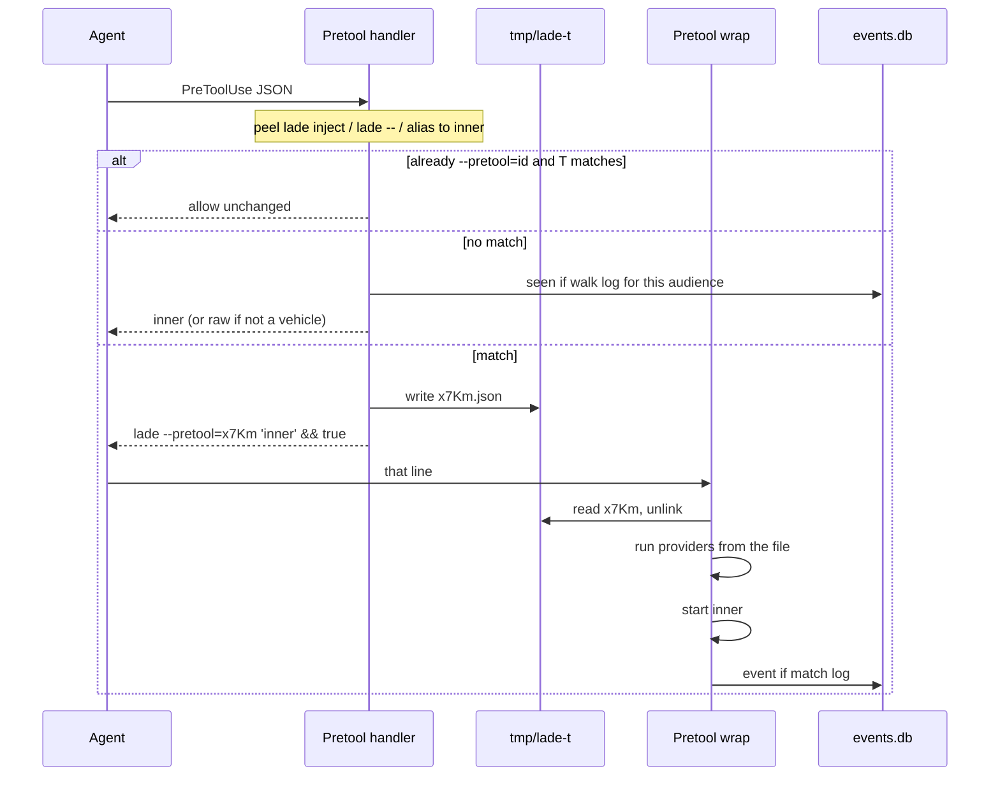
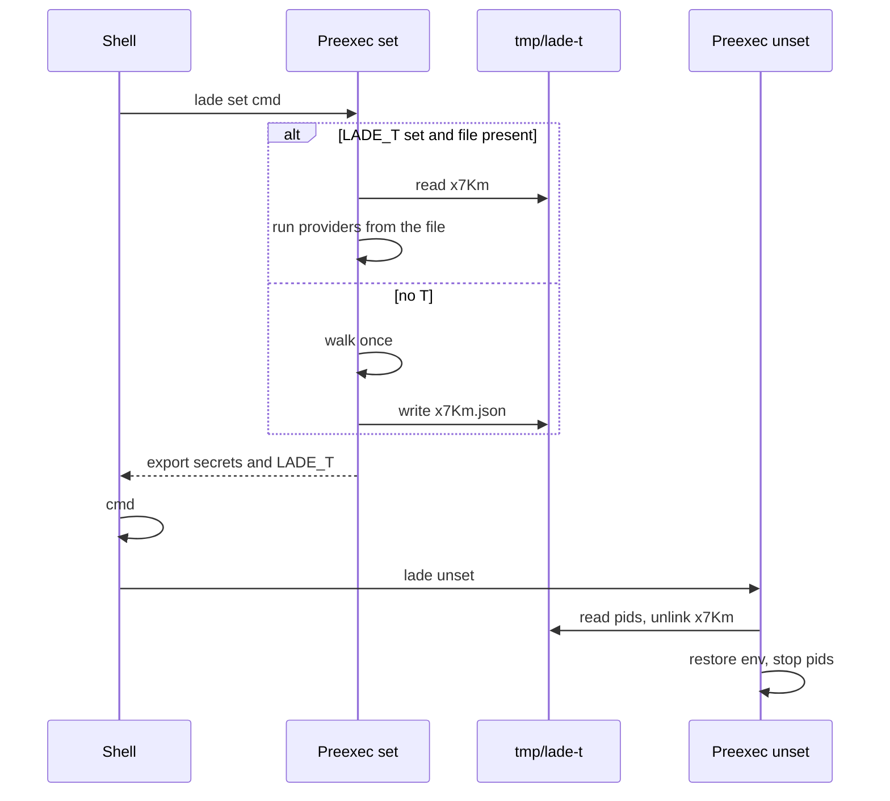

# T protocol

T is a 4-character id (`A-Za-z0-9`). File: `{temp_dir}/lade-t/{id}.json`.
The file is the pre-event: everything needed to run providers. No second
`lade.yml` walk. No rematch. Missing file: walk once, as a cold start.

Regenerate the id if `create_new` fails or if the id is `eval`, `help`,
`hook`, or `user`. Space-form `--pretool echo` stays a command: a 4-char
token after `--pretool` is an id only when that file already exists.
`--pretool=x7Km` always peels.

See also [architecture.md](architecture.md) and [observability.md](observability.md).

## Pass

| Surface | T |
|---|---|
| Pretool wrap | `--pretool` optional value: `lade --pretool=x7Km 'npm test' && true` |
| Preexec set | writes `{id}.json`, exports `LADE_T=x7Km` |
| Preexec unset / approve | `LADE_T` from the previous set |
| Direct inject, MCP, eval | none |

Env keeps `LADE_T` (preexec pointer), `LADE_RESTORE` (previous env, may
contain secrets), and `LADE_APPROVE` (command + 5 min window). Via,
network pids, and pending disclaimer live on the ticket. Leftover
`LADE_VIA` is ignored.

The child never sees the id or `LADE_T`. Direct inject ignores a leftover
`LADE_T` from a previous `set`. Unset unlinks if `LADE_T` is a valid id.

A pre-tool T no wrap read within an hour never will be: the harness
denied the command, another hook blocked it, or the line never ran
Lade. Each new pre-tool T sweeps those, and any T that does not parse.
A wrap that comes later walks the yaml instead. Pre-exec T stay: a
long command needs its own until `lade unset`.

## Surfaces

| Surface | What runs | Via |
|---|---|---|
| Pretool handler | Agent PreToolUse stdin | `pretool` |
| Pretool wrap | `lade --pretool[=id] <cmd>` (inject) | `pretool` |
| Preexec set | `lade set <cmd>` | `preexec` |
| Preexec unset | `lade unset` | (none) |
| Direct inject | `lade inject` / `lade <cmd>` | `organic` or `unknown` |
| Approve | then inject | same as inject |
| MCP spawn | `lade mcp` | `mcp` |
| MCP verb | `lade hook` (no T) | `mcp` |
| Eval URI | `lade eval <uri>` | `organic` or `unknown` |
| age plugin | `age-plugin-lade` | `organic` or `unknown` |

## Flow

## Paths

Diary `log` on a match is the last explicit `log` on **matching** rules.
No-match `seen` uses the last explicit `log` on the loaded walk that
applies to this audience. `log: true` does not mean the line is a
`lade inject` vehicle. Vehicle detect is argv shape only.

The handler never emits `lade inject …` or `lade --pretool inject …`.
`lade inject -- cmd`, `lade -- cmd`, and `lade cmd` (alias) peel to
`cmd`. A clap verb other than `inject` is not peeled. Yaml still sees
the full line, less the leading `cd <dir> &&` segments the handler
resolved (below). A finished wrap
(`--pretool=<id> 'cmd' && true` and T exists with that command) is left
alone. If T write fails, the rewrite is `lade --pretool -- 'cmd' && true`
and the handler still writes `seen` when log is on.

| Surface | T | Providers | Unlink | Diary |
|---|---|---|---|---|
| Pretool handler, no match | none | no | | `seen` if walk log |
| Pretool handler, peeled, no wrap | none | no | | `seen` if walk / match log |
| Pretool handler, match | writes | no | | wrap writes |
| Pretool wrap, id present | read | from file | wrap, once read | if match log |
| Pretool wrap, no id | none | walk | | if match log, `seen` on no match |
| Preexec set, `LADE_T` | read, keep | from file | unset | if match log |
| Preexec set, no `LADE_T` | write on match | walk | unset | if match log, `seen` on no match |
| Preexec unset | read pids | restore / pids / output files | yes, if `LADE_T` | no |
| Direct inject | none | walk | | if match log, `seen` on no match |
| Approve | read if `pending` | from file, then inject | wrap, after the child | if match log |
| MCP spawn | none | walk | | if match log, `seen` on no match |
| MCP verb | none | no | | `seen` if match log or walk log |

### Working directory

The handler walks from the directory the command runs in, not its own.
It starts at the payload's directory: `cwd` (Claude Code, Codex,
Cursor), then `tool_input.working_directory` (Cursor) or
`tool_input.workdir` (Codex, relative to `cwd`). The OpenCode plugin
sends neither, so the hook process directory is used. Each leading
`cd <dir> &&` then moves it: a literal relative or absolute path, `~`,
or `~/…`, that exists. The first segment that is anything else (`$VAR`,
quotes, `cd -`, a missing directory, `;`, a name `CDPATH` would search)
stops it there. T `cwd` is
that directory. The rewrite is still the whole line.

The wrap resolves the same `cd <dir> &&` segments from its own
directory, then reads that directory's yaml for pins, the cache, and
the diary row, and matches the rules on the rest of the line.
Pre-exec `set` and a direct `inject` do the same. Only the child starts in the harness's directory, and
runs the `cd` itself. A ticket written for another directory still
supplies the secrets, but skips the cache: a body is keyed by the
rule that holds it, and a value must never land in another rule's.

A line that is only `cd`, `pushd`, or `popd` with at most one literal
argument (`cd -` included) is never wrapped, whatever the rules say:
wrapped, it would move the child and not the harness shell. Anything
compound (`cd x && y`, `cd x; y`, `VAR=1 cd x`, `cd $(…)`) is a
normal line.

### Shell

Lade runs `cmd` in the shell that started it, its parent process:
the shell the command was written for. An inherited variable never
picks it. `SHELL`, the login shell, belongs to the terminal a
harness started from: a fish terminal, a Claude Code or Codex shell
in zsh. Every shell keeps `SHELL` as it found it.

bash, zsh, and sh exec the last command of a `-c` line in place of
themselves. Codex runs `zsh -lc '<rewrite>'`, so Lade's parent would be
Codex. The rewrite therefore ends with `&& true`: the shell stays,
and Lade's exit status is kept. fish never execs that way.

A pre-tool wrap whose parent is not bash, zsh, fish, or sh (dash
counts as sh) fails with a box, before any provider runs. No other
source says which shell the command was written for.

A direct `lade inject` or `lade approve` with no shell as parent runs
its line in `sh`. A task runner (make, npm scripts, just) runs a line
with `sh -c`, which execs Lade and leaves the runner as its parent:
that line was written for `sh`. So was one from `xargs` or a script's
subprocess.

`lade on`, `off`, `set`, `unset`, `setup`, and `hook enable --shell`
need a shell parent, which they always have from a shell hook.
`lade status` shows no pre-exec row without one.

## Disclaimer

T carries disclaimer **texts**. The gate stays in wrap / set
(`resolve_disclaimers`). The handler does not prompt.

The approve code is not the T id. It is
`sha256(command + "\n" + window)[:5]` hex, `window = unix_time / 300`
(5 minutes). Current and previous windows are accepted. The id is
already on `lade --pretool=x7Km`. Using it as `LADE_APPROVE` would let
an agent copy the wrap line and skip the disclaimer. An agent never
gets the code: only a human approves, from a terminal.

T is the messenger (command, cwd, disclaimers, work, agent, pids,
pending). `lade approve` reads `LADE_T`, requires `pending: true`,
verifies the code, then injects. A successful set cannot be
re-approved.

## Pre-event

`{temp_dir}/lade-t/{id}.json`. No secret values. Enough to call
providers with no YAML.

| Field | Content |
|---|---|
| `command` | Raw command |
| `cwd` | Directory of the walk |
| `via` | `pretool` or `preexec` |
| `audience` | `human` or `agent` |
| `actor` | Lade user or OS user |
| `log` | Last explicit `log` on the matched rules |
| `disclaimers` | Texts, already collected |
| `secrets` | `{key, source, private, output?, cwd}` user already resolved |
| `network` | `{key, uri}` |
| `matches` | Diary shape: `[{file, rule, bindings: [{key, uri}]}]` |
| `op_sa` | Optional 1Password service-account URI, not the token |
| `agent` | Free-form hook metadata (`harness`, `model`, `session`, …). Absent if empty |
| `network_pids` | Legacy: provider pids from a Lade before hub tunnels. Never written; `lade unset` still stops them after an upgrade |
| `pending` | `true` when preexec withheld a disclaimer. Absent otherwise |

## Event

Same `matches`. Outcome filled. INSERT if `log`. New uuid v7. T id is
not the row id.

| Field | Content |
|---|---|
| `id` | uuid v7 |
| `ts` | emit time |
| `kind` | `access` / `denied` / `seen` |
| `via` | `pretool` / `preexec` / `mcp` / `organic` / `unknown` |
| `audience` | `human` / `agent` |
| `actor` | same |
| `repo` | `git_stamp(cwd)` |
| `git_commit` | `git_stamp(cwd)` |
| `command` | Scrubbed match/display text |
| `command_truncated` | `command` cut at 1024 scalars |
| `argv` | JSONB object or array, or null |
| `hydrate_ms` | ms, or null |
| `matches` | from the pre-event, or `[]` |
| `agent` | Sparse hook metadata, or null |
